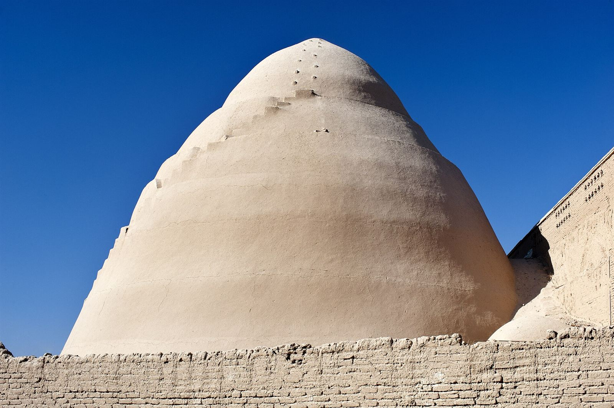
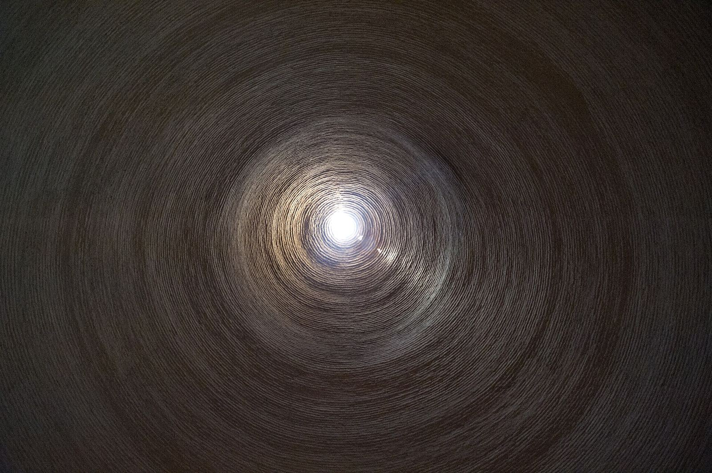

En el centro de Irán hay desiertos donde en verano se llega a los 40 grados. Y aun así, hace siglos, allí se tomaban postres helados en pleno verano. El truco eran los *yakhchal*, que en persa quiere decir algo así como «foso de hielo». Son unas cúpulas de barro enormes, con forma de cono, que servían para fabricar hielo en invierno y guardarlo hasta el verano. Sin electricidad y sin nada más que tierra, agua y sombra.

## Cómo se hace hielo en el desierto

Aquí está lo más curioso, y es pura física. Al lado de cada yakhchal había un estanque muy poco profundo, de unos 40 o 50 centímetros. El agua llegaba por los *qanat*, los canales subterráneos que los persas usaban para traer agua desde lejos.

Junto al estanque levantaban un muro largo y alto, orientado de este a oeste, que a menudo llegaba a los 10 metros. Así el agua quedaba siempre a la sombra por el lado norte y el sol no la calentaba.

Lo importante pasaba por la noche. El aire del desierto es muy seco y el cielo suele estar despejado, así que el agua pierde calor de dos formas: por evaporación y porque lo irradia hacia el cielo, que de noche está muy frío. En Yazd, en invierno, alguna noche se baja hasta unos 5 grados bajo cero. Con todo eso junto, el agua del estanque se congelaba.

Al amanecer, los trabajadores rompían el hielo y lo llevaban al interior de la cúpula antes de que saliera el sol.

<figure class="foto"><figcaption>El yakhchal de Meybod, en la provincia de Yazd.<small>Foto: <a href="https://commons.wikimedia.org/wiki/File:20110102_Ice_House_(exterior)_Meybod_Iran.jpg">Ggia</a> · <a href="https://creativecommons.org/licenses/by-sa/3.0">CC BY-SA 3.0</a> · Wikimedia Commons, redimensionada</small></figcaption></figure>

## Una cúpula que no deja pasar el calor

Guardar el hielo meses sin que se derritiera era lo difícil. La parte de abajo del yakhchal es un foso excavado en el suelo, y encima va la cúpula. Los muros se hacían con *sarooj*, un mortero que mezclaba arena, arcilla, cal, clara de huevo, pelo de cabra y ceniza. Era impermeable y aislaba muy bien.

Además, los muros son gordísimos: unos 2 metros en la base, y se van estrechando hacia arriba. La forma de cono también ayuda. El aire caliente sube y se queda arriba, en la punta, mientras abajo, donde está el hielo, se mantiene el frío.

El de Meybod, que se suele datar hace unos 400 años, tiene una cúpula de unos 15 metros y un foso de unos 5 metros de hondo. Según un estudio de la ingeniería británica Max Fordham, su estanque de unos 400 m² podía dar unos 50 m³ de hielo por invierno. En Kerman hay otro con un cono de 18 metros.

<figure class="foto"><figcaption>Así se ve la cúpula de Meybod desde dentro.<small>Foto: <a href="https://commons.wikimedia.org/wiki/File:20110102_Ice_House_(interior)_Meybod_Iran.jpg">Ggia</a> · <a href="https://creativecommons.org/licenses/by-sa/3.0">CC BY-SA 3.0</a> · Wikimedia Commons, redimensionada</small></figcaption></figure>

## Para qué servía tanto hielo

Con ese hielo se conservaba comida y se enfriaban bebidas en verano. También se usaba para postres, como el *faloodeh*, un dulce persa de fideos finos casi congelados.

Las primeras descripciones de cómo se fabricaba el hielo en estas construcciones son del siglo XVII. Luego llegaron las neveras modernas y los yakhchal dejaron de tener sentido. Pero muchos siguen en pie: un libro sobre el tema contó 129 en Irán. A mí me encantaría ver uno algún día, y el de Meybod lo tengo apuntado.

**Dato curioso:** muchos yakhchal tenían dos puertas. Por la del norte se metía el hielo en invierno y por la del sur se sacaba en verano.

Foto de portada: <a href="https://commons.wikimedia.org/wiki/File:Yakh-chal_in_Yazd_province_-_Iran_(cropped).jpg">reibai</a> · <a href="https://creativecommons.org/licenses/by/2.0">CC BY 2.0</a> · Wikimedia Commons, redimensionada.

