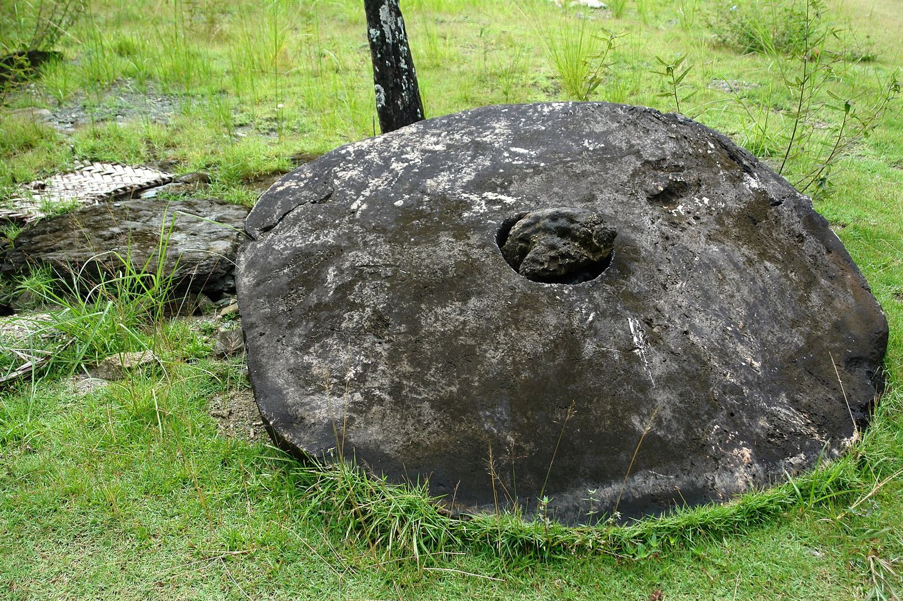
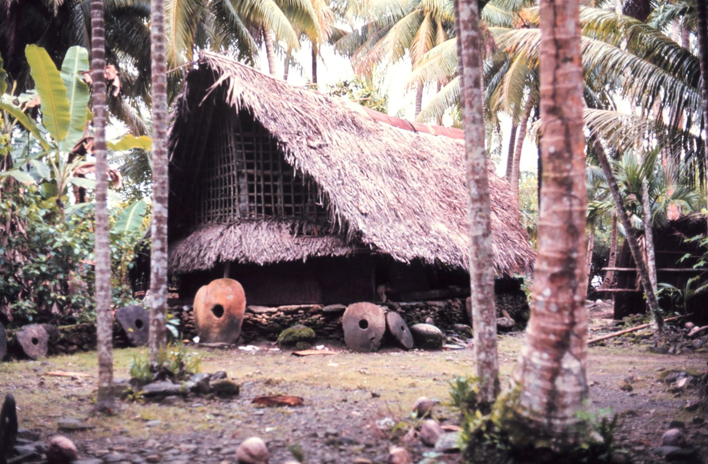

En las islas Yap, en Micronesia, en pleno Pacífico, hay unas 6000 piedras enormes repartidas por los pueblos. Son discos redondos con un agujero en el centro y se llaman *rai*. Durante siglos fueron el dinero más valioso de la isla. Lo raro es que casi nunca se movían de sitio. Cuando alguien pagaba con una, la piedra se quedaba donde estaba y lo único que cambiaba era el dueño.

## Dinero que no se mueve

La mayoría de los rai miden entre 30 y 50 centímetros, pero los hay muchísimo más grandes. El mayor que se conserva está en la isla de Rumung: mide 3,6 metros de ancho y pesa unas 4 toneladas.

Por eso, para saber de quién es cada piedra, no sirve mirar dónde está. Cada rai grande tiene su historia, que se transmite de palabra, con los nombres de todos sus dueños anteriores. Pagar con una piedra es, sencillamente, añadir un nombre nuevo a esa historia, y todo el pueblo lo sabe.

Hay un caso que lo resume muy bien. Una vez, una piedra grande que venía en canoa se cayó al mar y se hundió. Nadie la volvió a ver. Pero todos estuvieron de acuerdo en que seguía allí abajo, así que se siguió usando para pagar como cualquier otra.

<figure class="foto"><figcaption>Un rai tumbado en la hierba, en Yap.<small>Foto: <a href="https://commons.wikimedia.org/wiki/File:Yap_stone_money_1.jpg">Scot Nelson</a> · <a href="http://creativecommons.org/publicdomain/zero/1.0/deed.en">CC0</a> · Wikimedia Commons, redimensionada</small></figcaption></figure>

## Piedras que vienen de otra isla

En Yap no hay piedra de este tipo. Los rai son de calcita, un mineral que se forma muy despacio en las paredes de algunas cuevas de Palau, cuando el agua de lluvia se filtra por la roca caliza y va dejando capas. Palau está a unos 400 kilómetros al oeste de Yap.

Así que los hombres de Yap viajaban en canoa hasta allí, a veces durante años, con permiso de la gente de Palau a cambio de trabajo. Tallaban los discos en las canteras y hacían el agujero del centro, que servía para meter un palo y cargarlos. Para volver, las piedras grandes iban en balsas de bambú. Como las balsas eran lentas y difíciles de manejar, a menudo las soltaban antes para que las corrientes las llevaran hacia Yap, y luego salían detrás en canoa a buscarlas. Ese camino de vuelta podía superar los 1000 kilómetros. Muchas piedras se perdían en el mar y a veces moría gente.

El valor de un rai dependía de su tamaño, de lo bien tallado que estuviera y de su historia: si lo había traído un navegante famoso o si alguien había muerto por el camino.

<figure class="foto"><figcaption>Una casa comunal de Yap con sus piedras delante.<small>Foto: <a href="https://commons.wikimedia.org/wiki/File:Community_house_of_Yorlap_(Yap_Islands)_with_stone_money_made_in_Palau_NOAA.jpg">Dr. James P. McVey, NOAA Sea Grant Program</a> · <a href="https://commons.wikimedia.org/wiki/File:Community_house_of_Yorlap_(Yap_Islands)_with_stone_money_made_in_Palau_NOAA.jpg">Dominio público</a> · Wikimedia Commons, redimensionada</small></figcaption></figure>

## Cuando llegaron los barcos europeos

En el siglo XIX todo cambió. Con herramientas de hierro era mucho más fácil tallar, y los barcos europeos podían traer piedras más grandes y en más cantidad. Uno de los más conocidos fue David Dean O'Keefe, un irlandés-estadounidense que naufragó cerca de Yap en 1871 y luego se dedicó a transportar rai a cambio de copra y pepino de mar. Pero esas piedras «modernas» valían menos que las antiguas, justo porque habían costado menos esfuerzo.

A principios del siglo XX se dejaron de traer. Aun así, los rai se siguen usando hoy en ocasiones especiales, como bodas o herencias, y aparecen hasta en las matrículas de los coches. A mí me encantaría ver uno de esos «bancos» de piedras algún día.

**Dato curioso:** el economista Milton Friedman escribió en 1991 que este sistema no es tan distinto del oro guardado en la Reserva Federal de Nueva York, que puede cambiar de país dueño sin salir nunca de la cámara acorazada.

Foto de portada: <a href="https://commons.wikimedia.org/wiki/File:Ancient_Yapese_stone_money_-_8843919185.jpg">Scot Nelson</a> · <a href="http://creativecommons.org/publicdomain/zero/1.0/deed.en">CC0</a> · Wikimedia Commons, redimensionada.

