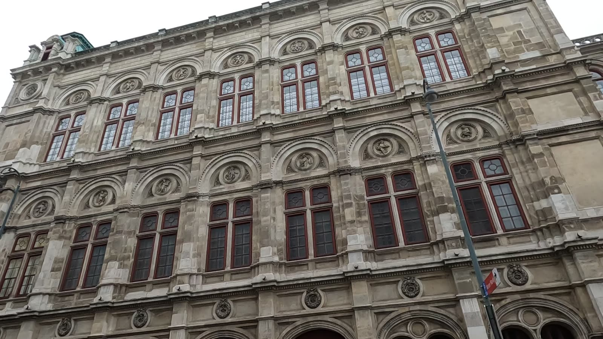
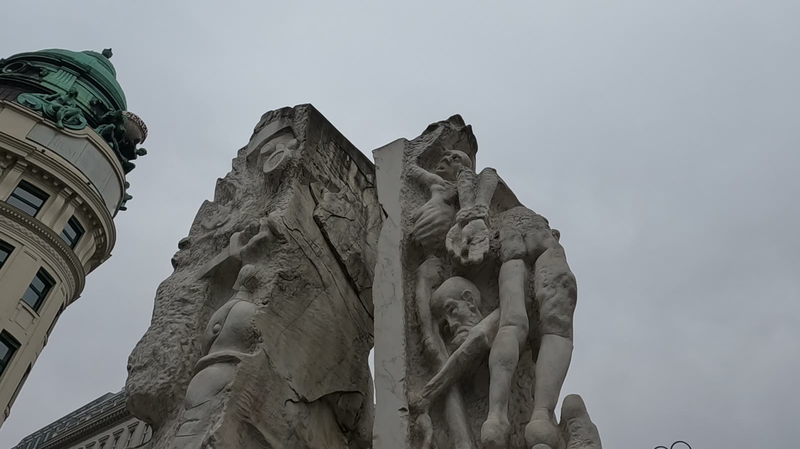
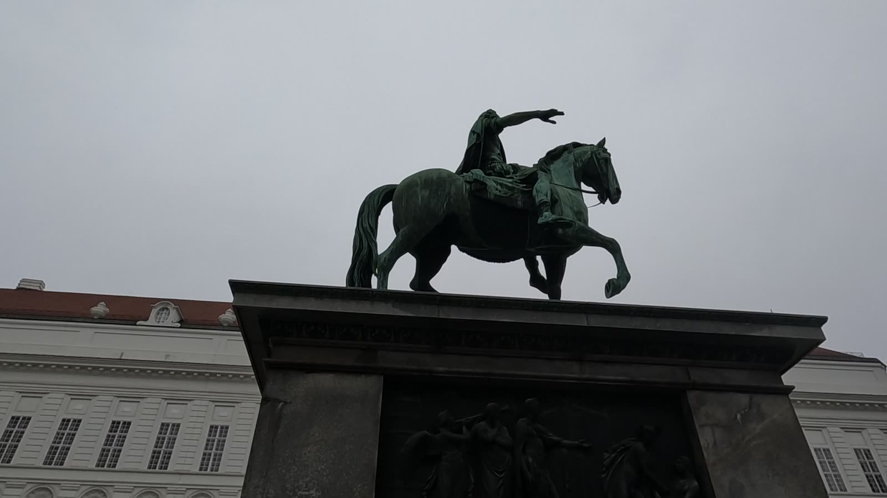
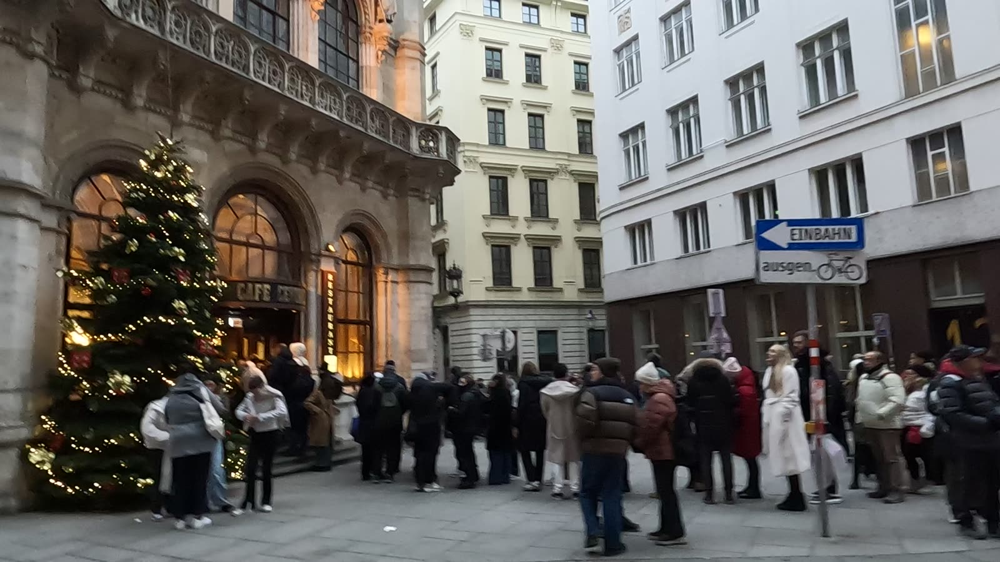
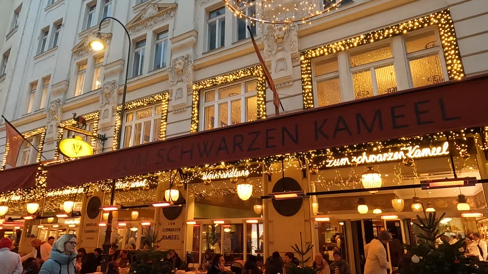
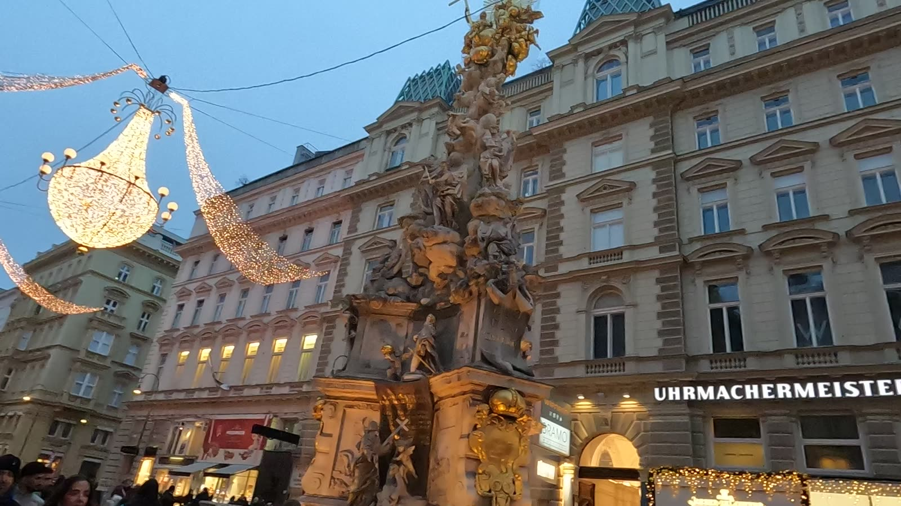

Llegué a Viena a finales de noviembre del año pasado, con un cielo gris, bastante frío y la ciudad ya preparada para la Navidad. Fue un día largo andando por el centro, y casi todo lo que cuento aquí está a pocos minutos a pie de lo siguiente.

## La Ópera

Empecé por la Ópera Estatal, en el Ring. Se inauguró en 1869 y es uno de los teatros de ópera más importantes del mundo. Aunque no entres, merece la pena verla de cerca: la fachada está llena de arcos, balcones y detalles.

<figure class="foto"><figcaption>La fachada de la Ópera Estatal.</figcaption></figure>

## Albertinaplatz: un monumento que impresiona

Justo detrás de la Ópera está la plaza de la Albertina. Allí se encuentra el Monumento contra la Guerra y el Fascismo, del escultor Alfred Hrdlicka. Está en el lugar donde, en 1945, un bombardeo derrumbó un edificio con cientos de personas refugiadas en el sótano. Son bloques de piedra enormes, y de cerca se entiende muy bien lo que quieren contar.

<figure class="foto"><figcaption>El Monumento contra la Guerra y el Fascismo, en Albertinaplatz.</figcaption></figure>

## El Hofburg

El Hofburg fue durante siglos el palacio de los Habsburgo, y es casi un barrio entero de patios y plazas. En la Josefsplatz está la estatua ecuestre del emperador José II, rodeada por los edificios de la Biblioteca Nacional. Un poco más adelante se llega a la Schweizertor, la puerta renacentista roja y negra que da acceso a la parte más antigua del palacio.

<figure class="foto"><figcaption>José II a caballo, en la Josefsplatz.</figcaption></figure>

## Cafés con cola en la puerta

En Viena los cafés son casi monumentos. En el Café Central, en la Herrengasse, la cola para entrar llegaba hasta la calle, con el árbol de Navidad en la puerta. Un poco más allá, en la Bognergasse, el Zum Schwarzen Kameel, que abrió en 1618, estaba lleno y decorado con luces por toda la fachada.

<figure class="foto"><figcaption>La cola del Café Central.</figcaption></figure>

<figure class="foto"><figcaption>El Zum Schwarzen Kameel, con la fachada iluminada.</figcaption></figure>

**Consejo:** si quieres entrar en uno de los cafés más famosos, ve temprano o cuenta con esperar un buen rato.

## El Graben al anochecer

Lo mejor del día llegó al final. En Navidad, el Graben se llena de enormes lámparas de araña hechas de luces, colgadas de lado a lado de la calle. En medio está la Columna de la Peste, levantada después de la epidemia de 1679, y al fondo se ve la torre de la catedral de San Esteban.

<figure class="foto"><figcaption>La Columna de la Peste, bajo las luces del Graben.</figcaption></figure>

**Consejo:** ve al Graben justo cuando empieza a anochecer. Todavía queda algo de luz en el cielo y las lámparas ya están encendidas.

## ¿Merece la pena Viena en Navidad?

Sí. Hace frío y hay mucha gente, pero la ciudad está preciosa y el centro se recorre fácilmente a pie. Lleva ropa de abrigo de verdad, que se nota.

¿Has estado en Viena o tienes pensado ir? [Escríbeme](/#contacto) y te cuento más.

Fotos: Marie Peachx.

