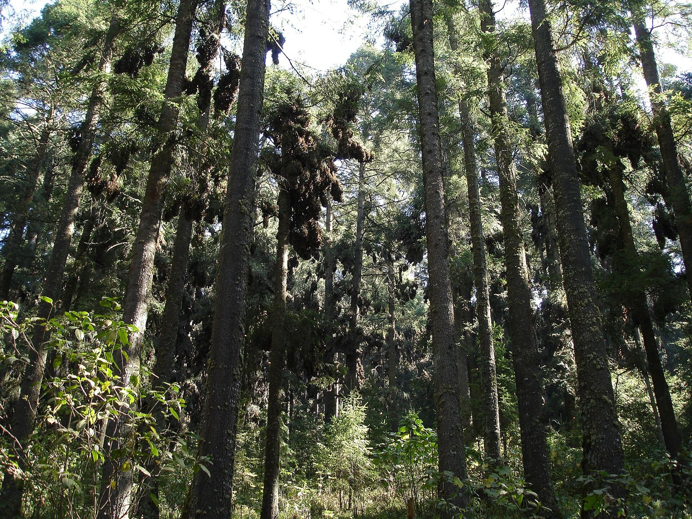
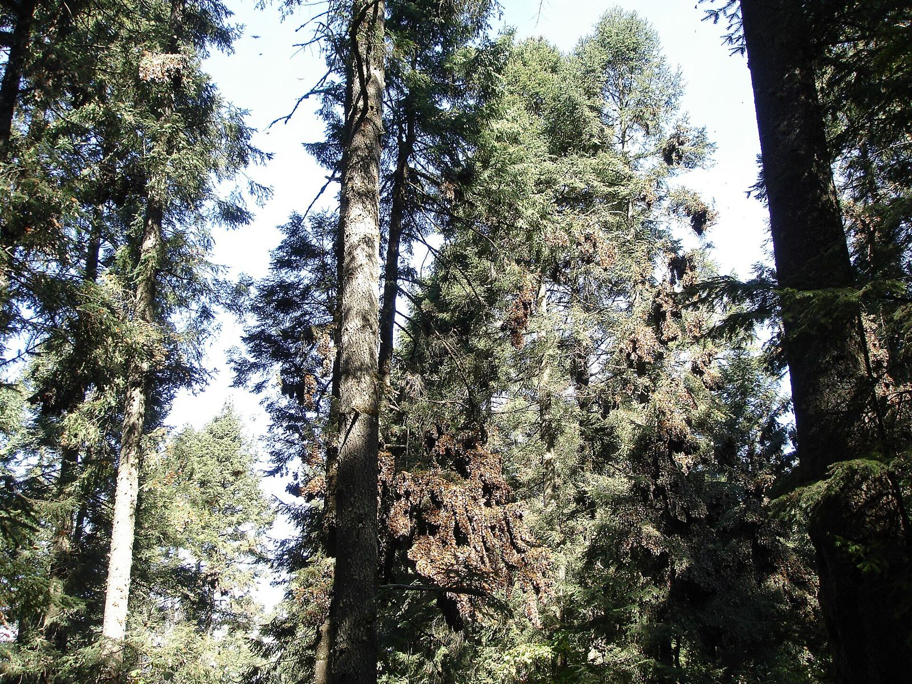

Cada otoño pasa algo increíble en Norteamérica. Millones de mariposas monarca salen del sur de Canadá y del norte de Estados Unidos y vuelan hacia el sur, algunas hasta 4830 kilómetros. Su destino son unos bosques de montaña en México, entre los estados de Michoacán y México. Lo más raro de todo es que ninguna de esas mariposas ha estado allí antes. Y aun así, llegan cada año a los mismos sitios.

## Una generación que vive mucho más

Las monarca normales viven poco: las que nacen a principios de verano duran menos de dos meses. En un año se suceden cuatro generaciones. Pero la última, la que nace al final del verano, es distinta. Esa generación vive unas ocho veces más que sus padres y sus abuelos, y es la que hace el viaje largo.

Empiezan a bajar en septiembre y octubre y llegan a los bosques mexicanos en noviembre. Allí pasan el invierno casi quietas, apiñadas en los árboles para no perder calor. En marzo empiezan a volver hacia el norte. Por el camino ponen huevos, y son sus hijos y nietos los que terminan el viaje de vuelta. Así que la mariposa que llega a México en otoño es la bisnieta, más o menos, de la que salió de allí la primavera anterior.

<figure class="foto"><figcaption>Racimos de mariposas en los oyameles de El Rosario, en Michoacán.<small>Foto: <a href="https://commons.wikimedia.org/wiki/File:Abies_religiosa_El_Rosario_7.jpg">hspauldi</a> · <a href="https://creativecommons.org/licenses/by-sa/2.0">CC BY-SA 2.0</a> · Wikimedia Commons, redimensionada</small></figcaption></figure>

## Árboles que se vuelven naranjas

Las mariposas no se paran en cualquier árbol. Eligen los oyameles (*Abies religiosa*), un tipo de abeto que crece en lo alto de montañas volcánicas. Se juntan tantas que cuelgan de las ramas en racimos enormes y los troncos se ven de color naranja.

La zona está protegida como Reserva de la Biosfera Mariposa Monarca, y en 2008 la UNESCO la declaró Patrimonio de la Humanidad. Para medir cómo va la población no se cuentan mariposas una a una, sino la superficie de bosque que ocupan. En el invierno de 2025 ocuparon 1,8 hectáreas, el doble que el año anterior.

Su llegada coincide con el Día de Muertos, a principios de noviembre, y en la tradición de la zona las dos cosas están muy unidas. A mí me encantaría ver uno de esos bosques llenos de alas algún día. Lo tengo apuntado.

<figure class="foto"><figcaption>Las ramas se doblan por el peso de las mariposas.<small>Foto: <a href="https://commons.wikimedia.org/wiki/File:Abies_religiosa_El_Rosario_10.jpg">hspauldi</a> · <a href="https://creativecommons.org/licenses/by-sa/2.0">CC BY-SA 2.0</a> · Wikimedia Commons, redimensionada</small></figcaption></figure>

## Cuando la ciencia por fin las encontró

Durante mucho tiempo los científicos sabían que las monarca se iban al sur, pero no adónde. Uno de los que más las buscó fue Fred Urquhart. En enero de 1975, Catalina Trail y Kenneth Brugger lo llevaron por fin a uno de los grandes bosques donde pasaban el invierno en México. Los detalles del hallazgo se publicaron en 1976.

**Dato curioso:** las monarca que viajan al sur no han visto nunca el bosque al que van. Cómo encuentran el camino sin que nadie se lo enseñe sigue siendo una de las preguntas más bonitas que estudia la biología.

Foto de portada: <a href="https://commons.wikimedia.org/wiki/File:Monarca.JPG">Fperezgo</a> · <a href="https://creativecommons.org/licenses/by-sa/3.0">CC BY-SA 3.0</a> · Wikimedia Commons, redimensionada.

