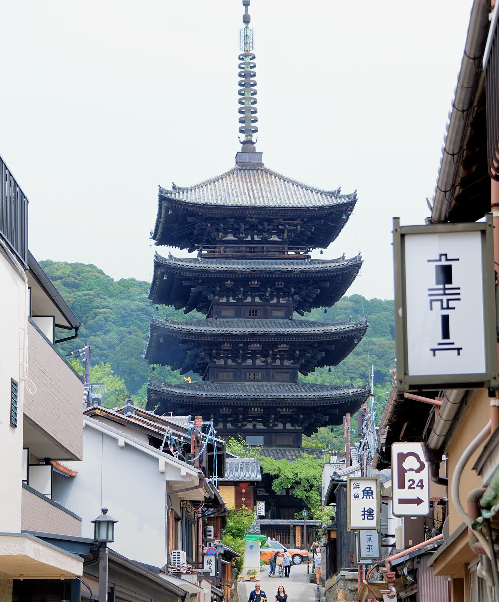
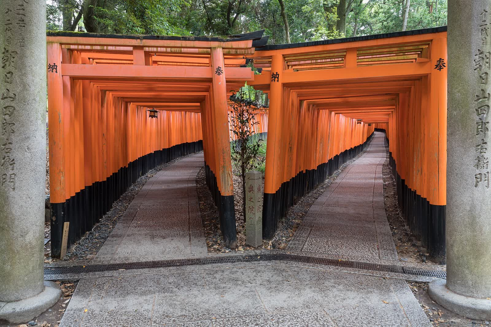
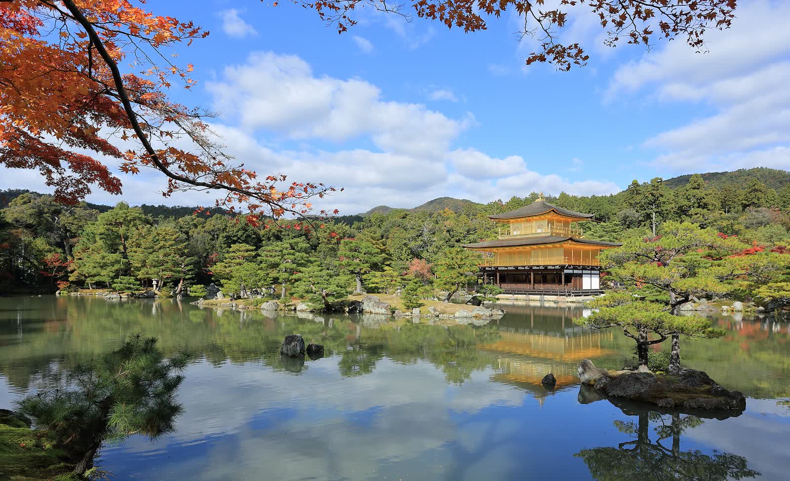
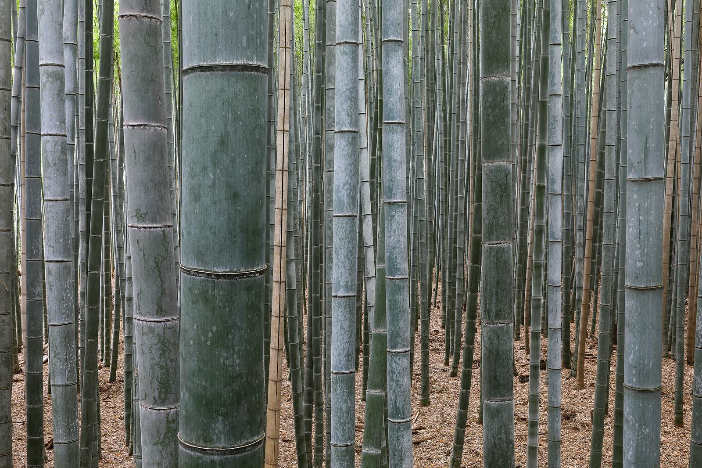
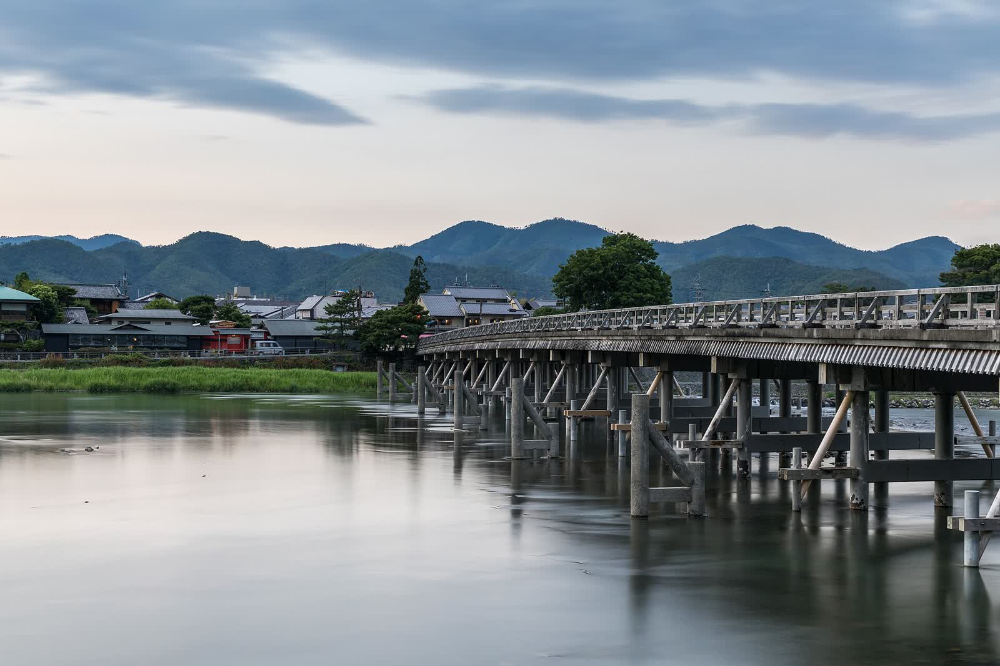

Todavía no he ido a Kioto, pero lo tengo apuntado desde hace tiempo. Es una de esas ciudades que salen en todas las fotos de Japón, y quería ordenar lo que me gustaría ver para cuando llegue el momento. Esto es lo que he ido recopilando.

## Un poco de historia

Kioto fue la capital de Japón durante más de mil años. La corte imperial se instaló allí en el año 794, cuando la ciudad se llamaba Heian-kyō, y no se trasladó a Tokio hasta 1869. Por eso tiene tantos templos, santuarios y jardines. En 1994, la UNESCO declaró Patrimonio Mundial un conjunto de 17 de estos lugares, entre ellos varios de los que cuento aquí.

## Kiyomizu-dera, el templo del escenario de madera

Es el que sale en la foto de portada. El templo se fundó en el año 778, y los edificios actuales son de una reconstrucción terminada en 1633. Lo más famoso es su enorme terraza de madera, a unos 13 metros sobre la ladera, sostenida por decenas de pilares. Está hecha con encajes de madera, sin un solo clavo. Desde arriba se ve toda la ciudad.

Para llegar se sube por calles empinadas del barrio de Higashiyama, llenas de casas tradicionales. En una de ellas aparece de golpe la pagoda Yasaka, de cinco pisos, una de las imágenes más típicas de Kioto.

<figure class="foto"><figcaption>La pagoda Yasaka, en Higashiyama. <small>Foto: <a href="https://commons.wikimedia.org/wiki/File:GIO_-_Yasaka_Pagoda_seen_from_Higashiyama_near_Gion,_Kyoto,_Japan,_2015.jpg">Josep M. Gracia</a> · <a href="https://creativecommons.org/licenses/by-sa/4.0">CC BY-SA 4.0</a> · Wikimedia Commons, recortada y redimensionada</small></figcaption></figure>

## Fushimi Inari y sus miles de torii

Si hay una imagen de Kioto que todo el mundo reconoce, es esta: caminos enteros cubiertos de puertas naranjas. Es el santuario de Fushimi Inari, dedicado a Inari, al que se pide prosperidad en los negocios. Según la tradición se fundó en el año 711. Los torii suben por la ladera del monte Inari y los donan empresas y particulares. Cada uno lleva escrito el nombre de quien lo regaló.

<figure class="foto"><figcaption>El punto donde el camino de torii se divide en dos. <small>Foto: <a href="https://commons.wikimedia.org/wiki/File:Double_torii_path_at_Fushimi_Inari_Taisha_Shrine,_Kyoto,_Japan.jpg">Basile Morin</a> · <a href="https://creativecommons.org/licenses/by-sa/4.0">CC BY-SA 4.0</a> · Wikimedia Commons, redimensionada</small></figcaption></figure>

**Consejo:** los primeros tramos son los que más gente tienen. Si sigues subiendo un poco, los caminos se van vaciando.

## El Pabellón Dorado

El Kinkaku-ji es un pabellón cubierto de pan de oro que se refleja en un estanque. Empezó siendo la villa de retiro del shogun Ashikaga Yoshimitsu, a finales del siglo XIV, y después se convirtió en templo zen. Lo que se ve hoy no es el original: en 1950 un joven monje le prendió fuego, y el pabellón se reconstruyó en 1955. Yukio Mishima escribió una novela sobre aquel incendio, *El pabellón de oro*.

<figure class="foto"><figcaption>El Kinkaku-ji en otoño. <small>Foto: <a href="https://commons.wikimedia.org/wiki/File:Kinkaku-ji_in_November_2016_-01.jpg">Martin Falbisoner</a> · <a href="https://creativecommons.org/licenses/by-sa/4.0">CC BY-SA 4.0</a> · Wikimedia Commons, redimensionada</small></figcaption></figure>

## Arashiyama: bambú y río

Al oeste de la ciudad está Arashiyama. Se llega en tren desde la estación de Kioto con la línea JR Sagano, y casi todo queda a un paseo de la estación. Lo más conocido es el bosque de bambú, un camino entre tallos altísimos. Muy cerca está el puente Togetsukyō, sobre el río, con las montañas detrás.

<figure class="foto"><figcaption>El bosque de bambú de Arashiyama. <small>Foto: <a href="https://commons.wikimedia.org/wiki/File:Bamboo_Forest,_Arashiyama,_Kyoto,_Japan.jpg">Basile Morin</a> · <a href="https://creativecommons.org/licenses/by-sa/4.0">CC BY-SA 4.0</a> · Wikimedia Commons, redimensionada</small></figcaption></figure>

<figure class="foto"><figcaption>El puente Togetsukyō al atardecer. <small>Foto: <a href="https://commons.wikimedia.org/wiki/File:Togetsu-kyo_bridge_at_dusk,_Kyoto,_Japan.jpg">Basile Morin</a> · <a href="https://creativecommons.org/licenses/by-sa/4.0">CC BY-SA 4.0</a> · Wikimedia Commons, redimensionada</small></figcaption></figure>

**Consejo:** el bosque de bambú se llena muy rápido. Lo mejor es ir a primera hora de la mañana.

## Cómo moverse y cuándo ir

Kioto tiene dos líneas de metro, una de norte a sur y otra de este a oeste, que se cruzan en la estación de Karasuma Oike. El resto lo cubren los autobuses urbanos, y lo más práctico es combinar los dos. Se pueden usar tarjetas recargables como ICOCA o Suica. El centro, además, es bastante llano y se recorre bien a pie.

Las mejores épocas son la primavera, con los cerezos en flor, y el otoño, cuando los arces se ponen rojos. También son las más concurridas, así que conviene madrugar.

Cuando por fin vaya, ya sé por dónde empezar. ¿Has estado en Kioto o tienes pensado ir? [Escríbeme](/#contacto) y te cuento más.

Foto de portada: <a href="https://commons.wikimedia.org/wiki/File:Kiyomizu-dera,_Kyoto,_November_2016_-01.jpg">Martin Falbisoner</a> · <a href="https://creativecommons.org/licenses/by-sa/4.0">CC BY-SA 4.0</a> · Wikimedia Commons, redimensionada.

